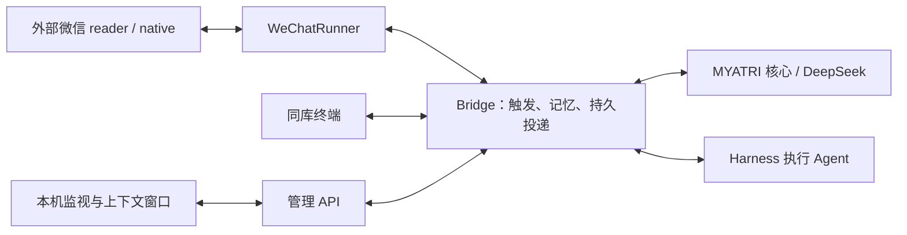

# 结构与修改入口

myatry 从 MYATRI-AstrBot 4428069 整合而来。保留其冻结 MYATRI 0.2.8 核心与已工作的业务逻辑，用直接微信传输替代 AstrBot 框架、插件安装和进程间消息转发。只有一个 pyproject、uv.lock 和 Python 环境。

## 运行路径

群聊和同库终端通过 `var/service.lock` 互斥。微信模式只使用一个 Bridge；管理 API 不再承担插件到后端的消息转发。启动前先认证微信账号及群白名单，再启动后台维护。关闭时先停止传输，再关闭 Bridge。

## 文件职责

| 位置 | 修改什么 |
| --- | --- |
| `src/myatri/` | 原始档案、索引、检索、人格、PAD、维护与模型账本；冻结核心源码，已移除旧 CLI/合成评测 |
| `src/myatry/__main__.py`、`launch.py` | 统一参数、模板准备、认证绑定、生命周期与启动组合 |
| `src/myatry/wechat_client.py` | 外部 reader/native HTTP 契约、账号/版本核对及发送回执 |
| `src/myatry/wechat.py` | 消息映射、直接调用 Bridge、逐段发送和报告轮询 |
| `src/myatry/bridge.py`、`local_chat.py` | 原群业务及同库终端；不是 AstrBot 插件 |
| `src/myatry/computer_*.py`、`reading_conversation.py`、`harness/` | 稳定 owner 授权、执行任务、原工具回合结果续接与工具实现 |
| `src/myatry/server.py`、`monitor*`、`context_viewer*` | 本机控制、Token/记忆/情绪监视、回复概率与实际请求 |
| `config/` | 角色卡、引擎参数、桥接/微信模板、Harness 锁文件及公开提示词 |
| `scripts/` | Harness 安装/独立 CLI，以及外部 reader 前台启动；不克隆第三方框架 |
| `docs/SOURCES.json`、`LICENSES/` | 原始来源/文件哈希、适配及裁剪说明、第三方许可 |

## 需保持的接口与数据

- `Bridge.receive(Incoming)` → `prepared` 时 `claim(id)` → 每段成功后 `acknowledge(id, 'sent', index)`；失败或回执不明标 `unknown`，不能自动重发。
- `WeChatRunner(bridge, client, platform_id='xiaowennuan-wechat', observe_only=False)`：`run()` 接收/轮询，`close()` 停自有任务和客户端，不关闭 Bridge。
- `server.create_app(bridge, token)` 提供既有管理协议并管理 Bridge 启停；UI 当前读取 `config/bridge.local.toml`，自定义配置不带 `--ui`。
- 平台 ID、scope 算法、默认 transport 和消息指纹保持原值。内部 `transport='astrbot'` 是历史协议标签，不是运行依赖。重命名它会影响旧记录兼容，不作为文案清理。
- Harness 的实际反馈进入原 `tool_call_id`，小温暖在原回合续答；报告投递不依赖主动闲聊开关。
- 微信群与 CLI 共用整个 `state_root`，终端身份由本机 owner 绑定；不能另建私聊库或把昵称当授权。查看器只发现本项目群库。
- 旧记忆不自动迁移。停机后复制完整库，并保留原身份与白名单；不能改写版本记录、只拷索引或删除任务账本来消除错误。

## 外部依赖与验证

微信客户端、匹配 native DLL、reader 和其运行环境仍是明确的外部依赖，不随源码打包；`project_dir` 配置其实际位置。电脑控制另需锁定的 Node/Harness 环境，不把上游整套桌面应用复制进项目。

改入口跑 `tests/test_entry.py`；改传输跑 `tests/test_wechat.py`；改报告/同库运行看 `test_reporting_preserved.py`、`test_library_preserved.py`；改查看器跑 `test_ui_scope.py`。这些使用假后端和临时库。不要把结构变更验证扩大成真实模型调用、微信群发或全量旧测试。

部署顺序见根 README；当前已验证和未验证范围见 STATUS/HANDOFF。
